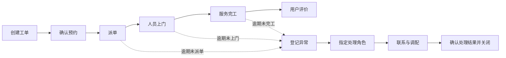

# 家电上门服务履约流程与异常规则

> 个人模拟项目。流程和规则用于展示服务运营分析方法，不代表京东或任何企业的实际业务规则。

## 项目边界

- **服务范围：**安装、维修、拆旧三类家电上门服务；模拟城市为北京、武汉、重庆。
- **分析对象：**约 600 条有效工单。基础版不设置取消订单；统计时，每条工单的预约上门及承诺完工截止时间均已到期。
- **运营问题：**哪些工单未按时派单、上门或完工？异常是否被记录并关闭？
- **时间口径：**所有时间均为北京时间，格式为 `YYYY-MM-DD HH:MM`。
- **数据边界：**后续只生成模拟数据，不收集真实客户姓名、电话或地址。

## 模拟依据与数据来源

本项目不要求使用企业真实历史工单。这里的“截止时间已到期”是**统计口径**：只分析预约上门和承诺完工截止时间都早于分析时点的工单，避免把仍在履约中的订单误判为超时；它不表示必须获取真实的旧数据。

| 设计内容 | 依据 | 对外表述 |
| --- | --- | --- |
| 下单、预约、派单、上门、完工、评价及异常处理 | 用户提供的京东校招岗位描述提到这些履约环节与异常管理工作 | 参考岗位描述设计的练习流程，不是京东内部流程 |
| 安装、维修、拆旧，北京、武汉、重庆，约 600 单 | 为覆盖不同业务场景和支持分组分析而设的项目假设 | 模拟范围，不代表实际业务量或城市结构 |
| 超时、投诉、异常关闭等字段与判定规则 | 根据岗位关注的履约质量、客诉及异常闭环目标设计；具体截止时间由每张模拟工单给出 | 本项目分析口径，不代表企业考核标准 |
| 各城市、服务类型、时段、异常率与投诉率的分布 | 尚无可引用的真实工单或公开统计依据 | 后续生成数据前列出参数和理由，明确标记为演示假设；不把模拟结果写成行业事实 |

后续生成数据时，先固定随机种子并保存生成规则，再检查工单时间先后顺序、异常类型、投诉与延误的关联，以及各组样本量。若找到可信的公开统计资料，只用来校准可比的参数，并记录来源、年份和适用范围；不把公开资料称为京东工单数据。

## 主流程

| 环节 | 需要记录的事实 | 模拟责任角色 | 本项目的判断点 |
| --- | --- | --- | --- |
| 创建工单 | 工单 ID、城市、服务类型、站点、创建时间 | 接单人员 | 是否形成有效工单 |
| 确认预约 | 预约上门截止时间、承诺完工截止时间 | 调度人员 | 两个承诺时间是否明确 |
| 派单 | 实际派单时间 | 调度人员 | 预约截止时是否仍未派单 |
| 人员上门 | 实际上门时间 | 服务人员 | 是否在预约截止前上门 |
| 服务完工 | 实际完工时间、工单状态 | 服务人员 | 是否在承诺截止前完工 |
| 用户评价 | 投诉标记、评分 | 用户 | 是否出现投诉或低评分 |
| 异常处理 | 异常类型、发现时间、关闭时间 | 站点运营人员 | 是否完成处理并确认关闭 |

## 主要异常的判定

以下规则只在工单对应截止时间已到期后使用。空的实际时间表示该动作尚未发生。

1. **派单超时：**`dispatched_at` 为空，或晚于 `appointment_deadline`。
2. **上门超时：**未触发派单超时，但 `arrived_at` 为空，或晚于 `appointment_deadline`。
3. **完工超时：**前两个环节均未超时，但 `completed_at` 为空，或晚于 `completion_deadline`。
4. **无：**上述三类均未触发。

一张工单可以在多个环节超时。`primary_exception` 只记录**流程中最早出现的异常**，优先顺序为派单、上门、完工；准时上门率和按期完工率仍各自独立计算。投诉另记在 `complaint_flag`，不自动改写主要异常类型。

## 异常处理支线

1. 截止时间触发规则后，填写主要异常类型和发现时间。
2. 由站点运营人员确认实际情况，联系调度或服务人员，并记录后续处理动作。处理动作将在第 8–9 天的 SOP 中详细设计。
3. 只有处理结果得到确认后才填写 `exception_closed_at`；空值表示仍未闭环。
4. 对外联系用户或调配服务资源只是模拟流程设计，本项目不会向真实用户发送信息。

## 三张工单的人工推演

| 工单 | 过程 | 主要异常 | 投诉 | 异常关闭 |
| --- | --- | --- | --- | --- |
| A | 按时派单、按时上门、按期完工 | 无 | 否 | 不适用 |
| B | 按时派单，上门与完工均超时 | 上门超时 | 是 | 已关闭 |
| C | 截止时未派单，未上门、未完工 | 派单超时 | 否 | 未关闭 |

这三张工单用于检验第 2 天的指标口径，不代表真实业务表现。

## 第 1 天验收

- 主流程的每个节点都有可记录的时间或结果。
- 三类主要异常有互不含糊的优先顺序。
- 能解释工单 B 为何记为“上门超时”，同时仍计入“未按期完工”。
- 能解释工单 C 的空上门时间为何不能算作准时上门。
