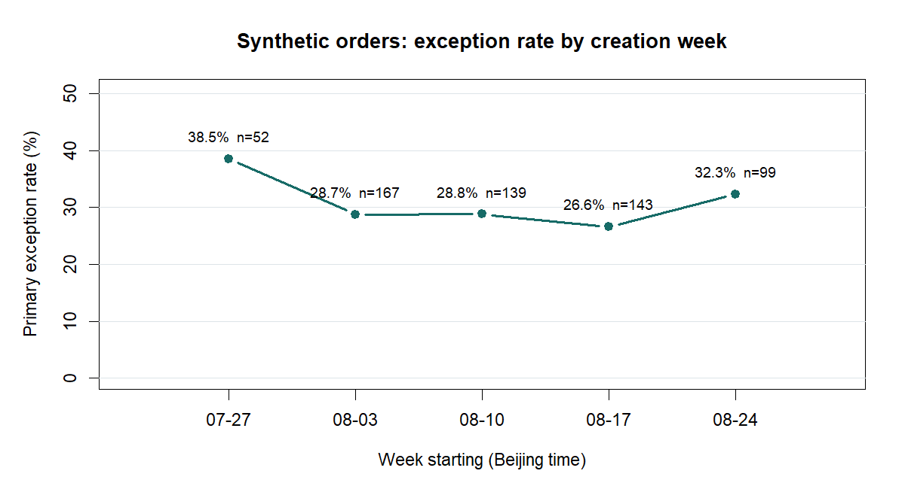

# 第 10–14 天：成果整理、R 复核与项目讲述

> 本项目为个人练习。所有工单均为合成数据，以下比例只描述这 600 条样本，不能作为京东或其他企业的运营结论。

## 第 10–11 天：让成果可读、可运行

1. 仓库首页提供一句话定位、看板截图、核心数字、分析结论、文件入口和复现方式。截图来自本仓库的 Excel `看板` 工作表；看板及 CSV 中的数字以仓库版本为准。
2. `streamlit_app.py` 读取同一份合成 CSV。城市、服务类型、站点筛选后，五项核心指标、站点明细和待闭环队列都会重算；不依赖外部接口。
3. 交互页与 README 均标明合成数据性质。站点差异由生成器主动设置，只能说明分析流程能发现预设信号。

## 第 12 天：R 独立复核

在仓库根目录运行 `Rscript 12_R复核.R`。脚本仅使用 base R，按同一统计时点过滤有效工单，输出 `12_R城市复核.csv` 和 `assets/12_R每周异常率.png`。城市汇总与 Excel 看板、Python 独立校验一致：

| 城市 | 有效单 | 准时上门 | 准时上门率 | 按期完工 | 按期完工率 | 投诉 | 主要异常 | 有关闭时间 |
| --- | ---: | ---: | ---: | ---: | ---: | ---: | ---: | ---: |
| 北京 | 252 | 206 | 81.7% | 223 | 88.5% | 14 | 61 | 32 |
| 武汉 | 193 | 149 | 77.2% | 162 | 83.9% | 10 | 59 | 30 |
| 重庆 | 155 | 114 | 73.5% | 121 | 78.1% | 16 | 58 | 34 |
| 合计 | 600 | 469 | 78.2% | 506 | 84.3% | 40 | 178 | 96 |

趋势图按**创建周**分组；首周和末周不是完整的 7 天，图中同时标出每周样本量。它只用于练习分组与可视化，不能证明某项运营措施带来了变化。

## 第 13–14 天：两分钟项目讲述

> 我针对家电上门服务的履约流程做了一个个人练习项目。先把下单到评价拆成预约、派单、上门、完工和异常处理节点，定义准时上门、按期完工、投诉与异常闭环的统计口径。因为没有企业真实数据，我用固定种子生成了 600 条合成工单，并在仓库明确公开了模拟规则和局限。
>
> 然后我做了 Excel 看板和 Streamlit 交互页，用 Python 独立校验时间戳，再用 R 复核城市汇总。样本中有 178 条主要异常，82 条尚无关闭时间。我按未完工或有投诉的条件提出 P1/P2 处理队列，也比较了同城站点与服务类型。比如武汉 WH02 的上门超时比 WH01 高，重庆 CQ01 的完工超时比 CQ02 高。但这些差异是模拟时设定的，所以我没有宣称发现真实根因。
>
> 最后我写了处理 SOP：异常复核、指定负责人、跟进、升级、确认结果和关闭。若放到真实场景，我会先补充排班、路程、配件和动作日志，再做小范围试点，同时看履约率、投诉率和返修等指标。这个项目主要展示的是我如何定义口径、发现问题、提出可验证的运营动作。

### 面试追问准备

- **为什么用合成数据？** 没有企业授权的真实工单；合成数据可公开复现流程，结果不代表实际业务。
- **闭环率 53.9% 说明什么？** 178 条有主要异常的样本中，96 条有关闭时间。它不能证明客户问题已经解决，因为没有负责人、行动、用户确认等证据。
- **为何站点差异不能当原因？** 生成器预设了 WH02 上门晚与 CQ01 完工晚的情景权重；还缺少排班、路程、配件和作业复杂度数据。只能把它当成待核查信号。
- **你会先做什么？** 先核对待闭环 P1 工单的实际状态和用户影响，明确负责人、下一动作、更新时间；再查跨站点差异的底层记录。

### 简历项目表述（按实际完成情况使用）

**家电上门服务履约监控与异常闭环｜个人合成数据项目**：设计预约—派单—上门—完工的指标口径和异常处理流程；基于 600 条固定种子合成工单，搭建 Excel 数据透视看板与 Streamlit 交互展示，并用 Python、base R 交叉复核城市指标；对 178 条主要异常提出 P1/P2 待办规则、原因验证资料和处理 SOP。**未接触京东真实业务数据，也未验证改善成效。**

## 暂缓的可选 AI 小实验

原计划可选项是：写 50 条**合成**异常描述并人工标注，用同一个提示词让对话式 AI 分类和提炼待核查信息，再统计分类正确数、错误类型与需人工复核的情况。它是检验 AI 辅助分诊可靠性的练习，不是本项目主线。当前阶段不执行，也不在简历中声称有 AI 实践成果。
