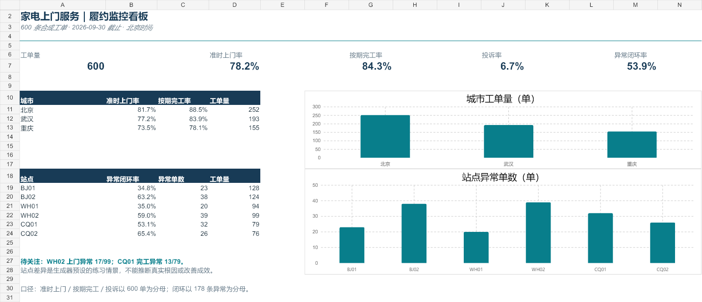

# 家电上门服务履约监控与异常闭环

面向服务运营校招的个人作品集：从预约、派单、上门、完工到异常处理，完成指标设计、履约看板、问题定位和处理方案。**600 条工单全部为合成数据，不是京东或其他企业的真实记录；站点差异是预设练习情景，不代表真实运营表现或改善成效。**



## 1 分钟看项目

- **监控：**在截至 2026-09-30 23:59（北京时间）的 600 条有效合成工单中，准时上门 469 单（78.2%）、按期完工 506 单（84.3%）、投诉 40 单（6.7%）。
- **定位：**按时间戳复算出 178 条主要异常，其中有关闭时间 96 条、待闭环 82 条；按建议规则进一步分为 P1 45 条、P2 37 条。
- **行动方案：**围绕武汉 WH02 的上门晚、重庆 CQ01 的完工晚，提出需补充的排班、路程、配件与处理日志，以及小范围试点的复核指标。原因尚未得到验证。
- **复核：**Excel 看板、Python 校验与 base R 城市汇总相互对账；另有可筛选的 Streamlit 展示页。

## 查看成果

| 成果 | 入口 |
| --- | --- |
| 在线交互看板 | 部署后在此补充链接；本地运行方式见下文 |
| Excel 看板 | [05-07_履约监控看板.xlsx](05-07_履约监控看板.xlsx)；含逐单公式、城市数据透视表、分组汇总和图表 |
| 异常分析与处理 | [08_异常定位与原因假设.md](08_异常定位与原因假设.md) · [09_异常处理SOP.md](09_异常处理SOP.md) |
| R 独立复核 | [12-14_复核与项目讲述.md](12-14_复核与项目讲述.md) · [12_R城市复核.csv](12_R城市复核.csv) · [趋势图](assets/12_R每周异常率.png) |

## 指标口径

仅统计预约上门与承诺完工截止时间都已过去的有效工单。准时上门率、按期完工率、投诉率以全部有效工单为分母；异常闭环率以有主要异常的工单为分母。“主要异常”按派单、上门、完工顺序保留最早失约环节，不能替代各环节独立的超时统计。有关闭时间不等于处理质量合格。

## 本地复现

生成与检查源数据只需 Node.js 和 Python 标准库：

```text
node generate_orders.mjs
python validate_orders.py
python analyze_exceptions.py
```

R 复核只需 base R，在仓库根目录运行 `Rscript 12_R复核.R`，输出城市汇总 CSV 和按创建周的异常率图。运行交互看板需安装 [requirements.txt](requirements.txt) 后执行 `streamlit run streamlit_app.py`。看板直接读取仓库内的 `03_模拟工单.csv`，筛选城市、服务类型和站点时重新计算指标与异常待办；无需账号或外部数据源。

| 文件 | 作用 |
| --- | --- |
| [01_业务流程.md](01_业务流程.md) | 履约流程、异常优先级、闭环框架 |
| [02_数据与指标设计.xlsx](02_数据与指标设计.xlsx) | 字段字典、指标口径与三单公式校验 |
| [03_模拟工单.csv](03_模拟工单.csv) / [03_模拟工单.xlsx](03_模拟工单.xlsx) | 600 条固定随机种子的合成工单 |
| [03_模拟数据说明与验收.md](03_模拟数据说明与验收.md) | 模拟依据、参数和限制 |
| [04_数据质量检查.md](04_数据质量检查.md) | 缺失值解释与总量对账 |
| [05-07_看板使用与分析说明.md](05-07_看板使用与分析说明.md) | Excel 使用方式及更新边界 |
| [12-14_复核与项目讲述.md](12-14_复核与项目讲述.md) | R 复核、面试讲述和简历写法 |

Excel 现有 600 行源数据修改后，公式汇总会重算；数据透视表需要手动刷新，新增行还需扩展公式与引用范围。详情见看板说明。项目没有真实人员、路程、配件、沟通或处理动作记录；提出的 SOP 和试点均未在真实业务中执行。
